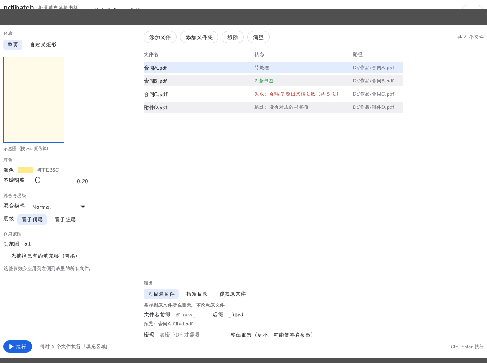
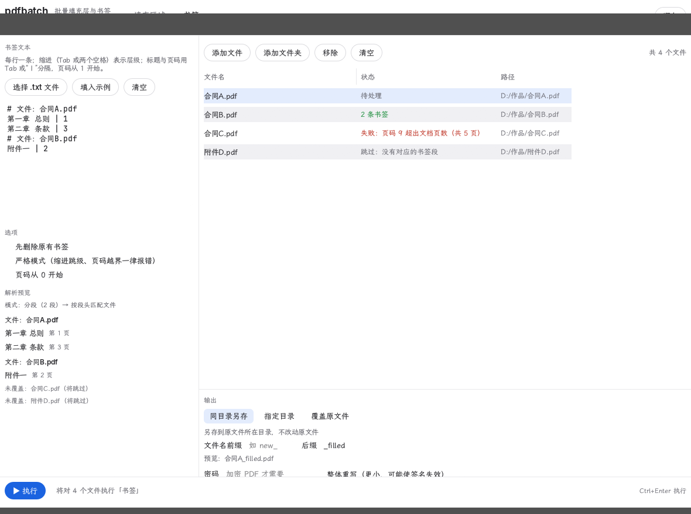

<p align="center">
  
</p>

<h1 align="center">pdfbatch</h1>

<p align="center">
  <b>给 PDF 批量加书签、批量盖填充层的小工具。</b><br>
  一个 Rust workspace，两个可执行程序：图形界面（与 PdfCraft 同款观感）与命令行，共用同一份核心逻辑。
</p>

<p align="center">
  
  
  
</p>

<p align="center">
  <a href="https://github.com/damnablefox/Pdfbatch">github.com/damnablefox/Pdfbatch</a>
</p>

---

## 它是什么

把 PdfCraft 里几件高频、但只能一个文件一个文件手动做的事，做成**批量**：

1. **按一份大纲文本，给一批 PDF 加书签**（支持多级层级，也支持把一份文本分成几段、分别应用到不同文件）；
2. **给一批 PDF 的指定页增 / 删 / 改纯色填充层**——新增时可控制混合模式（ExtGState `/BM`）与层级（盖在内容之上 / 垫在内容之下）；还能按填充区域、颜色、透明度、混合模式与页范围**查找匹配**，再批量删除或改写命中的填充层。
3. **批量调整页面尺寸**——按纸张（A0–A6 / Letter / Legal / Tabloid）或自定义尺寸缩放内容，或让**扫描件页面贴合其中的图像**（按 PPI 折算物理尺寸，四周不留白）；页范围支持奇偶页与相对写法。

对照 PdfCraft 的「编辑 PDF > 添加背景」，本工具是它的超集：多了**混合模式**、**置于顶层/底层**、**按条件查找并删改填充层**，以及**一次作用到多份文件**。

## 界面预览

<p align="center">
  
  <br>
  <sub>填充区域模式：左侧调参数，中间勾选文件，底部选输出方式（含文件名前缀/后缀与实时预览）。</sub>
</p>

<p align="center">
  
  <br>
  <sub>书签模式：分段文本 + 实时解析预览（模式提示、每段书签树、未覆盖文件提示）。</sub>
</p>

## 架构

组织方式与 PdfCraft 相同：workspace 根 + `crates/` 库 + `apps/` 多个独立二进制。核心逻辑不依赖界面，界面与命令行都调用同一份 `pdfbatch-core`，行为不会漂移。

| 路径 | Crate | 职责 |
|---|---|---|
| `crates/core` | `pdfbatch-core` | 核心逻辑：书签文本解析（含分段）、填充层构造、页面尺寸与扫描件适配、处理日志、批量文件管线、原子写入 |
| `crates/ui` | `pdfbatch-ui` | 图形界面层：与 PdfCraft 同风格的 egui 界面、主题与字体 |
| `apps/pdfbatch` | `pdfbatch` | 图形界面可执行程序 |
| `apps/pdfbatch-cli` | `pdfbatch-cli` | 命令行可执行程序 |

数据流：

```
参数（书签文本 / 填充 / 页面尺寸）
        │
        ▼
  pdfbatch-core  ──►  逐文件：打开 PDF → 修改 → 原子写回
        │                       （pdfcraft-cos / pdfcraft-organize 提供 PDF 引擎）
        ├──►  apps/pdfbatch-cli（打印每行结果）
        └──►  crates/ui → apps/pdfbatch（回填到文件列表）
```

PDF 引擎直接复用 PdfCraft 的库 crate（对象层、书签、页面模型），本工具只负责解析文本、解析参数、遍历文件、写回结果。

## 构建与运行

需要 Rust ≥ 1.90（`edition 2024`）。

本项目复用 [PdfCraft](https://github.com/storytold/pdfcraft) 的引擎 crate（尚未发布到 crates.io），并且是**相对路径引用**（`../pdfcraft/crates/*`）。因此要把两个仓库克隆到**同一个父目录**、让 `pdfcraft` 与 `pdfbatch` 平级：

```sh
# 1) 先取引擎源码（必需，必须在 pdfbatch 之前就位）
git clone https://github.com/storytold/pdfcraft.git pdfcraft   # 若你用的是自己的 fork，换成对应地址

# 2) 再取本项目
git clone https://github.com/damnablefox/Pdfbatch.git pdfbatch

# 3) 构建（在 pdfbatch 目录里）
cd pdfbatch
cargo build --release          # 产物：target/release/pdfbatch.exe 与 pdfbatch-cli.exe
cargo test                     # 单元测试（核心 + 界面 + 命令行）
```

克隆后的目录结构：

```
your-workspace/
├── pdfcraft/     ← 引擎源码（必需）
└── pdfbatch/     ← 本项目
```

> **注意**：只克隆 `pdfbatch` 一个仓库是**无法构建的**——Cargo 会去找同级的 `../pdfcraft` 目录，找不到就直接失败。请按上面的顺序把两个仓库放在一起。

### 依赖

- **PdfCraft 引擎（必需）**：见上，[Cargo.toml](Cargo.toml) 以路径依赖 `../pdfcraft/crates/*` 引用它的对象层（`cos`）、内容流解析（`content`）、书签与页面模型（`organize` / `model`）等 crate。其中 `content` 用于扫描件适配时遍历页面内容流、定位图像。
- **中文字体（已内置）**：界面中文使用**霞鹜文楷**，字体文件随仓库提供（`assets/fonts/LXGWWenKai-Regular.ttf`，SIL OFL 1.1），因此**无需任何额外构建输入**，构建产物一定能正常显示中文。
  如需换成自己的字体，替换 `assets/fonts/` 下的字体文件并调整 [`crates/ui/src/theme.rs`](crates/ui/src/theme.rs) 的字体栈即可（原来的 [craft-fonts](https://github.com/storytold/craft-fonts) 就是一份类似的、可替换的字库）。

Windows 便携版用**静态 CRT** 构建（`RUSTFLAGS=-C target-feature=+crt-static`），在没有安装 VC++ 运行库的机器上也能直接运行。

## 图形界面

双击 `pdfbatch.exe` 运行。窗口分四块：

- **左侧参数面板**：随顶栏三个标签页切换——
  - **填充区域**：顶部三种操作（**新增 / 删除 / 修改**）——
    - **新增**：整页或自定义矩形（含按 A4 估算的示意图）、颜色、不透明度、**混合模式**（16 种）、**层级**（置于顶层/置于底层）、页范围、"先摘掉已有填充层"；
    - **删除**：只填**查找条件**（填充区域 / 颜色 / 透明度 / 混合模式 / 层级 / 容差），点「查找匹配」显示命中数量，命中非零才能执行删除；
    - **修改**：上半是查找条件，下半是**更改要求**（区域改成整页或矩形，颜色/透明度/混合模式/层级各自可单独勾选），同样先查找、命中非零才能执行；
    - 页范围三处共用，支持相对写法：`all except first,last`（跳过封面封底）、`-1`（末页）、`2..-2` 等；
  - **页面尺寸**：顶部两种方式——
    - **按目标尺寸缩放**：预设纸张（A0–A6 / Letter / Legal / Tabloid）或自定义宽高（pt / mm / cm / in）、方向（纵向 / 横向 / 跟随原页面）、缩放模式（适应页面 / 填充页面 / 内容拉伸 / 自定义比例 / 只改页面尺寸 / 适应宽度 / 适应高度）、旋转（保持 / 0° / 90° / 180° / 270°，选 0° 即把 `/Rotate` 归零并入内容变换）；
    - **扫描件适配**：让页面尺寸贴合页面上的图像（像素 ÷ PPI × 72），可选 PPI、检测严格度（严格 / 宽松）、是否按「图像合集外框」适配多图、图像旋转（自动 / 保持 / 0–270°）；
    - 页范围共用，除 `1-5,8`、`all except first,last` 外还支持 `odd` / `even` 奇偶页；
  - **书签**：选择 `.txt` 文件或直接粘贴；右侧有实时**解析预览**（显示当前是「无段头」还是「分段」模式、树形层级、逐行报错与匹配状态），选项有"先删除原有书签 / 严格模式 / 页码从 0 开始"。
- **中间文件列表**：可添加文件/文件夹，或直接把文件拖进窗口；目录会递归收集其中的 PDF。列表列为「上/下移 · 序号 · 文件名 · 提示 · 状态 · 路径」——最左侧是左右并排的「上」「下」按钮，逐行调整顺序；表头「文件名」旁的按钮可按文件名排序（在升序 / 降序之间循环）；「提示」列在查找匹配时显示逐文件命中数量，执行时显示完成摘要、跳过原因或错误信息；提示、状态、路径列按内容自适应，文件名列可拖动调节宽度，列太宽时用底部的水平滚动条查看，悬停可看完整文本。
- **输出区**：输出方式（同目录另存 / 指定目录 / 覆盖原文件）、**文件名前缀与后缀**（对同目录另存与指定目录都生效）、密码、是否整体重写、**是否输出处理日志**（csv / json，位置固定为可执行文件同级目录）、失败后是否**失败即停**。
- **底部执行条**：`▶ 执行`（参数不合法时禁用并说明原因）、进度条与`取消`。

快捷键：`Ctrl+O` 添加文件，`Ctrl+Enter` 执行。右上角可切换浅色/深色主题。

> 界面左侧的参数会应用到**列表里的所有文件**——这就是"应用到多份文件"。

## 命令行

```powershell
$pdfbatch = ".\pdfbatch-cli.exe"

# 1) 整目录批量加书签（用同一份大纲）
& $pdfbatch bookmarks "D:\pdfs" --spec ".\examples\outline.txt" --out-dir "D:\out"

# 2) 给一批 PDF 的每一页盖一层淡黄、正片叠底、置于内容之上
& $pdfbatch fill "D:\pdfs" --full-page --color "#FFF3B0" --opacity 0.25 --blend Multiply --layer top

# 3) 只给第 1-5、8 页盖一个自定义矩形，垫在最底层
& $pdfbatch fill "D:\a.pdf" --rect "72,72,400,120" --color "#88CCFF" --opacity 0.2 --layer bottom --pages "1-5,8" --in-place

# 4) 删掉「淡黄、正片叠底」的填充层，但跳过每份 PDF 的封面与封底
& $pdfbatch fill "D:\pdfs" --erase --match-color "255,224,140" --match-blend Multiply --pages "all except first,last"

# 5) 把命中的填充层改成半透明、置于底层
& $pdfbatch fill "D:\pdfs" --modify --match-blend Multiply --set-opacity 0.5 --set-layer bottom

# 6) 批量缩放到 A4（内容等比缩放、居中，只处理奇数页）
& $pdfbatch pagesize "D:\a.pdf" --size A4 --mode fit --pages "odd" --in-place

# 7) 扫描件适配：页面尺寸贴合图像（300 PPI），并输出 CSV 处理日志
& $pdfbatch pagesize "D:\scans" --scan --ppi 300 --out-dir "D:\out" --log csv
```

各子命令都接受**多个文件或目录**；目录默认递归收集其中的 `.pdf`。
**默认不会改动原文件**，而是在同目录另存（文件名加后缀），要覆盖原文件请显式加 `--in-place`。

### 书签文本格式

缩进表示层级（一个 Tab，或每两个空格）；标题与页码之间用**最后一个** Tab 或 ` | ` 分隔；
页码从 1 开始；`#` 开头是注释，空行忽略。

```text
# examples/outline.txt
第一章 绪论 | 1
  1.1 研究背景 | 2
  1.2 研究意义 | 3
第二章 方法 | 4
  2.1 数据集 | 4
    2.1.1 采集流程 | 4
```

- 层级跳级默认会"钳制 + 警告"，加 `--strict` 则直接报错；
- 页码越界、标题为空都会报错并**指出行号**；
- `--zero-based` 可把页码改成从 0 开始解释；
- `--replace` 先删掉文档原有书签（默认是追加到已有书签之后）。

#### 分段文本：一份文本给多个文件

在文本里用**文件段头**，把书签分给不同的文件：

```text
# 文件：报告.pdf
第一章 绪论 | 1
# 文件：附录.pdf
附录 A 数据 | 1
```

- 段头要写**完整文件名**（含 `.pdf` 后缀，大小写不敏感）；也可写 `# 文件：#2` 按文件顺序（从 1 开始）指定。
- **两种写法互斥**：整份文本没有段头 → 应用到所有文件；一旦出现段头 → 按段头匹配文件。
- 段头**之前**不能出现书签行（会报错并指出行号）；界面的解析预览会显示当前模式与匹配状态。
- 列表里没有对应段的文件会被**跳过**（界面上会提示）；同一个文件写了多段会按顺序合并。

### 填充参数

`fill` 子命令有三种操作，默认「新增」。删与改会先按**匹配条件**查找，命中数非零才执行。

**新增：**

| 参数 | 说明 |
|---|---|
| `--rect x,y,宽,高` | 填充矩形，PDF 用户空间坐标（单位点，原点在页面左下角） |
| `--full-page` | 整页填充（默认），用页面的 CropBox |
| `--color <颜色>` | 颜色，默认 `#FFE08C`。见下方「颜色写法」 |
| `--opacity <0..1>` | 不透明度，默认 0.2 |
| `--blend <模式>` | 混合模式：Normal、Multiply、Screen、Overlay、Darken、Lighten、ColorDodge、ColorBurn、HardLight、SoftLight、Difference、Exclusion、Hue、Saturation、Color、Luminosity |
| `--layer top\|bottom` | `top` 盖在原有内容之上（默认）；`bottom` 垫在原有内容之下 |
| `--replace` | 先摘掉本工具此前加在该页的填充层，再重画 |

**删除 / 修改（`--erase` / `--modify`）：**

| 参数 | 说明 |
|---|---|
| `--erase` | 删除命中的填充层 |
| `--modify` | 修改命中的填充层，至少给一个 `--set-*` |
| `--match-full-page` | 只匹配整页填充 |
| `--match-size w,h` | 只比宽高（不看左下起点） |
| `--match-rect x,y,宽,高` | 完整匹配左下起点与宽高 |
| `--match-color <颜色>` | 匹配颜色（写法同 `--color`） |
| `--match-opacity <0..1>` | 匹配不透明度 |
| `--match-blend <模式>` | 匹配混合模式 |
| `--match-layer top\|bottom` | 匹配层级 |
| `--tolerance <数值>` | 数值比较容差，默认 0（精确相等） |
| `--set-rect x,y,宽,高` / `--set-full-page` | 把区域改成某个矩形 / 改成整页 |
| `--set-color <颜色>` | 改成该颜色 |
| `--set-opacity <0..1>` | 改成该不透明度 |
| `--set-blend <模式>` | 改成该混合模式 |
| `--set-layer top\|bottom` | 改成该层级 |

三种区域粒度（`--match-full-page` / `--match-size` / `--match-rect`）互斥；`--erase` / `--modify` 与新增专用开关不能混用。
不给任何匹配条件时，表示匹配**本工具加在该范围内的全部填充层**。

**颜色写法**（`--color` / `--match-color` / `--set-color` 通用）：十六进制 `#RRGGBB` / `#RGB`（如 `#FFF3B0`）、0–255 整数 `255,237,203`、归一化浮点 `1.0,0.93,0.8`（带小数点即按 0.0–1.0 解释）。

**页范围**（`--pages`）支持与页数无关的相对写法：

| 写法 | 含义 |
|---|---|
| `all` | 全部页（默认） |
| `1-5,8,10-` | 第 1–5、8 页，以及第 10 页到末页（旧写法完全兼容） |
| `first` / `last` | 第 1 页 / 末页 |
| `-1` / `-3` | 倒数第 1 页 / 倒数第 3 页 |
| `2..-2` / `5..` | 第 2 页到倒数第 2 页 / 第 5 页到末页 |
| `odd` / `even` | 奇数页（第 1、3、5… 页）/ 偶数页（第 2、4、6… 页） |
| `all except first,last` | 除封面封底外的所有页（也可写 `1..100 except 1,-1`） |

**批量改混合模式/层级**的老做法仍然可用：改完参数加 `--replace` 再跑一遍——旧层会被摘掉，只留新层；更精确的做法是用 `--modify --match-*` 只改命中的层。
（本工具添加的填充层在流字典里带 `PBMark` 标记，并把矩形、颜色、透明度、混合模式、层级记进专属的 `PBInfo` 属性字典，因此可以**不解压页面内容**就精确查找；旧版本留下的、没有 `PBInfo` 的层会回退解析内容流取回属性。）

### 页面尺寸参数

`pagesize` 子命令有两种方式，默认「按目标尺寸缩放」，加 `--scan` 切到「扫描件适配」。

**按目标尺寸缩放：**

| 参数 | 说明 |
|---|---|
| `--size <纸张>` | 预设尺寸：A0–A6、Letter、Legal、Tabloid |
| `--width <宽>` `--height <高>` | 自定义尺寸（与 `--size` 互斥） |
| `--unit pt\|mm\|cm\|in` | 自定义尺寸的单位，默认 mm |
| `--orientation portrait\|landscape\|auto` | 纵向（默认）/ 横向 / 跟随原页面 |
| `--mode <模式>` | fit 适应页面（默认）/ fill 填充页面 / stretch 内容拉伸 / percent 自定义比例 / resize 只改页面尺寸 / fit-width 适应宽度 / fit-height 适应高度 |
| `--percent <百分比>` | 配合 `--mode percent`，如 `150` |
| `--rotate keep\|0\|90\|180\|270` | 保持原 `/Rotate`（默认）或指定角度；选 `0` 即「归零并并入内容变换」 |

**扫描件适配：**

| 参数 | 说明 |
|---|---|
| `--scan` | 启用扫描件适配（与缩放参数互斥） |
| `--ppi <数值>` | PPI，默认 300 |
| `--strictness strict\|lenient` | 严格（页面恰有一张图，默认）/ 宽松（忽略小图・水印・背景） |
| `--merge-images` | 多图时按「图像合集外框」适配（默认跳过多图页面） |
| `--image-rotate auto\|keep\|0\|90\|180\|270` | 图像旋转，默认 auto |

页面尺寸 = 图像像素 ÷ PPI × 72（点）。多图取各图像**绘制区域的并集外框**折算，**不做像素级拼合**：不新建图像对象，图与图之间的空隙会成为页面内部留白（页面四周无留白）。

内容变换以 `q <矩阵> cm` 的形式插到内容流最前，并打 `PBScale` 标记；对同一页重复处理会先摘掉上一次的变换，**不会叠加缩放**。

### 处理日志

`--log csv` 或 `--log json` 开启（CLI 与图形界面都提供）；不指定就不产出。位置默认是**可执行文件同级目录**，文件名形如 `pdfbatch-log-20261013-153000.csv`；CLI 可用 `--log-dir <目录>` 改位置。字段为：文件名 / 完整路径 / 页码 / 结果 / 原因 / 新页面尺寸。任务结束（或被取消）后一次性落盘。

`--stop-on-error` 让某个文件失败后停止整批（默认继续下一个）。

### 共用参数

| 参数 | 说明 |
|---|---|
| `--out <文件>` | 写到指定文件（只允许单个输入） |
| `--out-dir <目录>` | 写到指定目录；**目录输入会保留其相对子路径**，并在需要时自动创建 |
| `--in-place` | 覆盖原文件（先写临时文件，再原子替换） |
| `--prefix <前缀>` | 输出文件名前缀（同目录另存与 `--out-dir` 都可用） |
| `--suffix <后缀>` | 输出文件名后缀（同目录另存默认 `_bookmarked` / `_filled` / `_resized`；`--out-dir` 默认不加） |
| `--full-save` | 整体重写（体积更小，但会让已有数字签名失效） |
| `--log csv\|json` | 产出处理日志；默认写到可执行文件同级目录 |
| `--log-dir <目录>` | 处理日志的存放目录 |
| `--stop-on-error` | 某个文件失败后停止整批（默认继续） |
| `--password-file <文件>` | 加密 PDF 的密码（文件内容即密码） |
| `--no-recursive` | 目录输入时不进入子目录 |

### 保存行为

默认**增量保存**：原始字节原样保留、只追加更新，因此**已有数字签名不会失效**（已在带签名的样张上验证：输出文件以原文件字节开头）。加 `--full-save` 才整体重写，此时签名会失效。

写文件一律是**原子写**：先写同目录下的临时文件，再改名替换目标，不会留下半个文件。

## 引用项目与致谢

本项目的 PDF 引擎、界面风格与字体都建立在下面这些项目之上：

| 项目 | 链接 | 用途 | 许可 |
|---|---|---|---|
| **PdfCraft** | https://github.com/storytold/pdfcraft | PDF 引擎库 crate（对象层、内容流、书签、页面模型）；界面配色/布局/字体规范也参考自它 | MIT OR Apache-2.0 |
| **craft-fonts** | https://github.com/storytold/craft-fonts | 内置中文界面字体（霞鹜文楷）的来源 | SIL OFL 1.1 |
| **LXGW WenKai 霞鹜文楷** | https://github.com/lxgw/LxgwWenKai | 界面中文字面 | SIL OFL 1.1 |
| **Inter** | https://github.com/rsms/inter | 界面西文字体 | SIL OFL 1.1 |
| **JetBrains Mono** | https://github.com/JetBrains/JetBrainsMono | 界面等宽字体 | SIL OFL 1.1 |
| **egui / eframe / egui_extras** | https://github.com/emilk/egui | 图形界面框架 | MIT OR Apache-2.0 |
| **rfd** | https://github.com/PolyMeilex/rfd | 原生文件选择对话框 | MIT |
| **png** | https://github.com/image-rs/image-png | 解码窗口图标 | MIT OR Apache-2.0 |
| **winresource** | https://github.com/mxre/winres | 在 Windows 构建时嵌入图标与版本信息 | MIT |

字体许可原文随仓库提供：`assets/fonts/OFL-Inter.txt`、`assets/fonts/OFL-JetBrainsMono.txt`、`assets/fonts/OFL-LXGWWenKai.txt`。

## 贡献者

| 贡献者 | 角色 |
|---|---|
| [damnablefox](https://github.com/damnablefox) | 项目发起、需求与验收、方案审查、图标设计 |
| Trae CN | 开发平台（IDE / 智能体） |
| DeepSeek-V4.1-Flash | 代码生成模型 |

## 本项目是如何完成的

> **本项目完全使用 [Trae CN](https://www.trae.cn/) 平台搭配 DeepSeek-V4.1-Flash 模型完成。**

从需求梳理、架构设计、全部代码实现、测试到便携版打包，整个过程都在 Trae CN 里由 DeepSeek-V4.1-Flash 完成；人负责提出需求、审查方案与验收结果。

| 指标 | 数值 |
|---|---|
| 完成平台 | Trae CN（产品端 TRAE；模式 max） |
| 使用模型 | DeepSeek-V4.1-Flash |
| 消耗积分 | **1137.58** |
| 完成耗时 | 约 17.5 小时（2026-10-10 23:04 → 2026-10-11 16:32，共 20 次会话） |
| 完成时间 | 2026 年 10 月 10–11 日 |

<details>
<summary>积分消耗明细（20 次会话，合计 1137.58）</summary>

| 时间 | 使用记录 | 模型名称 | 模式 | 产品端 | 积分消耗 |
|---|---|---|---|---|---|
| 2026/10/11 16:32 | 整理 pdfbatch项目文件，我用于上 | DeepSeek-V4.1-Flash | max | TRAE | 72.53 |
| 2026/10/11 16:05 | 好的，加上模式提示 | DeepSeek-V4.1-Flash | max | TRAE | 16.14 |
| 2026/10/11 16:02 | 我希望这个书签功能支持两种格式化文本写法 | DeepSeek-V4.1-Flash | max | TRAE | 23.5 |
| 2026/10/11 15:57 | 我希望这个书签功能支持两种格式化文本写法 | DeepSeek-V4.1-Flash | max | TRAE | 2.46 |
| 2026/10/11 15:42 | 1.段头写法使用推荐写法。 2.段头前的 | DeepSeek-V4.1-Flash | max | TRAE | 127.06 |
| 2026/10/11 14:39 | 对于书签功能，可以使用一份自定义格式化文 | DeepSeek-V4.1-Flash | max | TRAE | 20.8 |
| 2026/10/11 14:13 | 我觉得文件名状态和路径列宽不应该限制上限 | DeepSeek-V4.1-Flash | max | TRAE | 65.85 |
| 2026/10/11 12:16 | 1.布局让输出区和文件列表区域解耦。 2 | DeepSeek-V4.1-Flash | max | TRAE | 31.51 |
| 2026/10/11 11:55 | 文件列表只有右侧有滚动条，但是底部没有滚 | DeepSeek-V4.1-Flash | max | TRAE | 47.03 |
| 2026/10/11 11:31 | 按照优化方案执行优化。 | DeepSeek-V4.1-Flash | max | TRAE | 43.61 |
| 2026/10/11 11:10 | 我使用 pdfbatch.exe 时 | DeepSeek-V4.1-Flash | max | TRAE | 15.61 |
| 2026/10/11 9:30 | Prompt | — | — | TRAE | 21.19 |
| 2026/10/11 8:55 | 我在打开pdfbatch.exe后发现左 | DeepSeek-V4.1-Flash | max | TRAE | 122.86 |
| 2026/10/11 8:32 | 我发现构建后的pdfbatch.exe在 | DeepSeek-V4.1-Flash | max | TRAE | 23.11 |
| 2026/10/11 1:58 | 我发现填充选择的颜色色值不正确。我选择了 | DeepSeek-V4.1-Flash | max | TRAE | 49.08 |
| 2026/10/11 1:37 | 我在运行pdfbatch.exe时会同时 | DeepSeek-V4.1-Flash | max | TRAE | 15.46 |
| 2026/10/11 0:28 | 保留CLI但使用和pdfcraft项目一 | DeepSeek-V4.1-Flash | max | TRAE | 158.51 |
| 2026/10/11 0:11 | 你把pdfbatch项目做成了命令行项目 | DeepSeek-V4.1-Flash | max | TRAE | 102.37 |
| 2026/10/10 23:55 | 构建pdfbatch项目为便携式。并放入 | DeepSeek-V4.1-Flash | max | TRAE | 23.28 |
| 2026/10/10 23:04 | 根据PdfCraft项目，帮我制作一个项 | DeepSeek-V4.1-Flash | max | TRAE | 155.62 |
| **合计** | | | | | **1137.58** |

</details>

## 注意与已知限制

- **PDF 没有真正的 z-order**：层级只能靠"内容流绘制顺序 + `q`/`Q` 隔离"实现。`bottom` 只保证"排在多数原有内容之前"，如果页面自带不透明底图，仍会盖住填充。
- **`/BM` 的兼容性**：Acrobat、Chrome、Edge 支持良好，一些轻量查看器会忽略它（退化成 Normal）。
- **书签 API 不支持颜色/样式**（PdfCraft 的 `Bookmark` 只有标题、打开状态、子节点）。
- 处理加密 PDF 用界面上的"密码"框或 CLI 的 `--password-file`；密码不会写入日志。
- 依赖是 `path` 引用，PdfCraft 升级时这里可能需要跟着调整。

## 许可

本项目代码：**MIT OR Apache-2.0**，任选其一（见 [LICENSE-MIT](LICENSE-MIT)、[LICENSE-APACHE](LICENSE-APACHE)）。

界面内嵌字体：Inter、JetBrains Mono 与霞鹜文楷（LXGW WenKai）均为 SIL Open Font License 1.1；引擎来自 PdfCraft 的库 crate（MIT OR Apache-2.0）。各资产的作者、来源与许可见上表及 `assets/fonts/`。